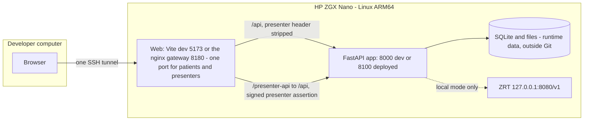
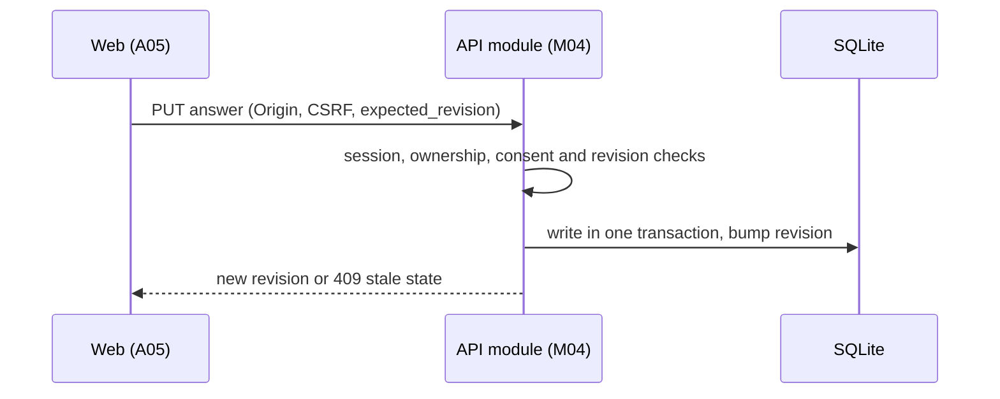
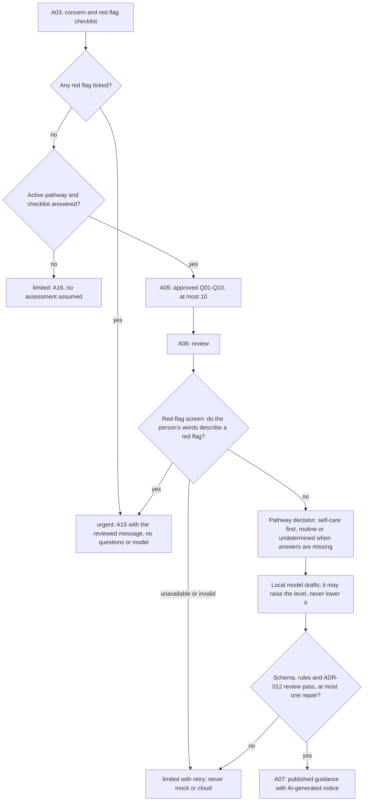

# Architecture

Engineering detail lives in [`spec/engineering/`](<your-repo-url>/blob/main/spec/engineering/01-architecture.md); this page is the map.

## Runtime on a ZGX device (Nano and Fury)

The same layout runs on the HP ZGX Nano and, since ADR-018, the HP ZGX Fury (GB300). Each device has its own deploy
configuration, which names the device (the gateways answer `/aware-care-device.js`, read by the web app before it
starts) and selects the API's per-device model manifest, inventory and telemetry prices (`infra/` for the Nano,
`infra/fury/` for the Fury). The diagram shows the Nano.

- Everything binds `127.0.0.1`. The browser reaches the web server through an SSH tunnel.
- **One address (#487):** the browser opens http://127.0.0.1:18180. Its home page offers two choices, Patient and
  Presenter. Patient pages call `/api`; the presenter tools (`/presenter/...`) call `/presenter-api`. There is no
  second port.
- **Browser policy (#157):** the gateway sends a strict Content-Security-Policy (`'self'` only; `data:` and `blob:` images for the W06 slide; `frame-ancestors 'none'`), `X-Frame-Options: DENY` and, since #576, `Permissions-Policy` (no camera, microphone, geolocation, payment or USB) and `Cross-Origin-Opener-Policy: same-origin` on every response. The browser tests serve the build with the same policy, so every browser test runs under it, and `tests/tooling/test_security_headers.py` keeps the copies equal.
- The deployed containers use host networking, so container loopback is the host loopback where ZRT listens ([ADR-010](<your-repo-url>/blob/main/spec/decisions/ADR-010-delivery-workflow.md)).
- **Presenter access** (ADR-005 option A, amended by #487): the gateway's presenter path `/presenter-api` works only
  when a presenter key is configured and the gateway binds loopback. The deploy tool refuses a key with any other bind.
  The path signs every request with a short-lived HMAC assertion. `/api` strips any such header. The API grants and
  honors the presenter role only with a valid assertion. Presenter and patient sessions use separate cookies, and the
  verified assertion decides which one applies. One browser can therefore present and demo at once.
- **Mock mode** never contacts ZRT. **Local mode** uses ZRT only and fails visibly; there is no cloud or mock fallback.

## Application structure

| Layer | Location | Notes |
|---|---|---|
| Web | [`apps/web`](<your-repo-url>/blob/main/apps/web/README.md) | React, TypeScript, Vite. API types generated from [`openapi.json`](<your-repo-url>/blob/main/spec/api/openapi.json); no health data in browser storage. One site name on every tab, "Aware Care - Local AI Healthcare Demo on ZGX Nano via ZRT" (on the Fury, "…on ZGX Fury…": the name comes from the deployment's device since ADR-018), with the official HP logo as the tab icon, bundled (#107). HP-branded design system in `src/styles.css` (tokens, components, screens; bundled Inter typeface; contrast checked by `scripts/check_contrast.py`) and, on every route, a truthful local-AI signature for the HP ZGX Nano and ZRT that claims a running model only when readiness and observed responses prove it (`src/components/Brand.tsx`, #98, record) |
| API | [`apps/api`](<your-repo-url>/blob/main/apps/api/README.md) | FastAPI modular monolith, one module per owner (M01–M12) under `app/modules/` |
| Inference boundary | [`runtime/adapter.py`](<your-repo-url>/blob/main/apps/api/app/runtime/adapter.py) | Every model call goes through it; schema and semantic checks run server-side |
| Fixtures | [`fixtures/`](<your-repo-url>/blob/main/fixtures/README.md) | Synthetic scenarios, questions, providers, records |

## Telemetry (W06, ADR-017)
The public page `/telemetry` shows what the local AI did on the device and what the same work would cost through a cloud
LLM API. It uses content-free data only:
- **`model_calls`:** every model call goes through `runtime/metering.py`, a wrapper around the runtime adapter. It
  records the task, prompt version, outcome, duration, the token counts ZRT reports (`usage`), and the GPU energy
  integrated from host power samples. There is no case, actor or text, the time is the hour only, and rows are kept
  90 days: the 5-minute cleanup removes older rows whether or not AI calls are still made (#471).
- **Events:** content-free events record published, failed (fail closed), repaired, urgent routes and busy refusals.
- **Power:** a read-only host sampler (`infra/telemetry/power_sampler.py`, `nvidia-smi power.draw`, one reading per
  second) writes hourly files into the API's data directory. It is kept running by cron, and a call without covering
  samples has no energy value.
- **Prices:** `infra/telemetry-pricing.json` is a reviewed price list with sources and retrieval dates, never fetched
  at run time. It holds three cloud references: the same model hosted, Claude Sonnet 5.5 and GPT-6 Astra (#127).
- **Whole-system power:** not measurable in software on this Nano (GPU power only; module power N/A). The calculator
  takes an assumed non-GPU wattage over the measured AI time, labeled Estimated (#127).
- **Share as a slide:** W06 builds the figures and the calculator's scenario as one 16:9 slide on the device
  (`W06Slide.ts`). It is a self-contained SVG with the logo embedded, offered as Download SVG or as a PNG drawn on a
  canvas (#129).

`GET /api/v1/telemetry` aggregates these for 24 hours, 7 days or since this release:
- **Every figure runs up to now** (#638, ADR-017 amendment of 2026-10-27): usage and cost totals (AI calls, tokens, AI
  time, call timings, output speed and GPU energy) and outcome figures (consultations, urgent routes, repairs,
  fail-closed results, busy refusals, AI calls by task, errors and guidance times) count the same whole hours, from the
  hour the period starts in up to the end of the current hour (`counted_from` / `counted_to`), so a consultation counts
  as soon as it happens. Last 24 hours and Last 7 days are rolling windows; "Since this release" runs from the
  release's start. Breakdowns below 5 are withheld. W06 names the window's start ("26 Oct 2026, 14:00 UTC to now").
- **Running mode:** figures count only the running mode's activity (#271). The snapshot's `consultations.counting_since`
  names when outcome counting began on this device (the first event that recorded the mode, by the hour). W06 shows it
  when it is later than the window start, and the slide names only the span actually counted (#324, #436).
- **Per-consultation figures** come from one window (#398). `metered` gives the consultations guided and the AI calls,
  tokens, AI time and GPU energy of the same whole hours: the outcome window up to now, from the outcome
  counting start and the first whole hour of metering on (#124). The calculator's defaults, the privacy sentence and
  the slide's scenario divide only these and name that window. The measured volume divides the counted consultations
  by the days actually counted.
- **Percentiles** interpolate linearly between closest ranks, the ADR-002 qualification's definition, so the median of
  two values is their mean (#441).
- **In the browser:** the page computes the estimates from those numbers and the editable assumptions, and shows each
  formula. A field the viewer empties or fills with an invalid value is marked, and the results keep the last valid
  value (#438, #439).
- **Mock mode** runs no model. The scripted calls are counted, but W01, W06 and the slide name them as scripted, and
  the snapshot gives no qualification network check (#437).

Nothing on the page leaves the device.

## A guarded request

Every applicable request checks ownership, role, consent, Origin and CSRF. Request bodies accept JSON numbers only: NaN and Infinity are refused with 422 and never stored (#261). A case's `confirmed_context` takes profile context only: kinds in the server's own namespaces (`answer:`, `fixture:`, `record:`) are refused with 422 (`confirmed_context.kind`, code `reserved`), so only `saveAnswer` writes answers and only answers to issued questions are counted (#433). Every authenticated response also carries `X-Session-Expires-At`: the session's expiry after that request, the earlier of 30 minutes idle and 8 hours. The patient shell uses it to warn 2 minutes before a guest session ends, with "Stay signed in" ([ADR-013](<your-repo-url>/blob/main/spec/decisions/ADR-013-session-expiry-signal.md), #42); so do the public pages while a session is open (#399). The tabs of one browser pass the latest expiry to each other (a same-origin `BroadcastChannel` carrying two times), and "Your session has ended" shows only after a quiet read returns 401 (#409). Generated guidance is validated before publishing. The certainty check (R25) treats a flagged phrase in a statement as a tripwire. Medication-change phrases ("stop taking", "dose", "switch your", "painkiller" and similar) are tripwires too (#85), and so are dosing and change phrasings such as "stop the tablets", "take two ibuprofen every six hours" or "halve your metformin" (#407). The local model then decides through the runtime adapter whether the statement really asserts a diagnosis, guaranteed safety, a ruled-out risk, a prescription change or a numeric confidence; any reviewer failure rejects the draft ([ADR-012](<your-repo-url>/blob/main/spec/decisions/ADR-012-certainty-check-with-local-review.md)). Jobs recheck every publication guard in the commit transaction before publishing a result: owner, deletion tombstone, state, case revision and reviewed revision; an export also checks that the guidance it rendered is still current. A result that fails any guard is marked stale or cancelled, and its bytes are removed. Jobs run in memory. When the API starts, work a previous process left unfinished is settled first: guidance, export and extraction jobs fail as interrupted (a consultation that was generating offers a retry, answers kept), a queued record's bytes are removed, and deletions run again to completion (#263). A doctor card is read with the search it was opened from; a card from a replaced search is refused (409) instead of showing another search's match (#267).

**Deletion leaves no copy (QA fixes, 2026-10-19).** SQLite runs with `secure_delete`, and every purge checkpoints and truncates the write-ahead log, so deleted text stays in neither the database nor the WAL file (#274). Record bytes are written in the same transaction that records them, and files no record references are removed at startup and by the regular cleanup (#272). Operational events keep the hour only and never an urgency level, and a deleted case's job rows keep only content-free, hour-precision timing samples (#275). When a session ends (logout, expiry, or a presenter reset of a demo patient), every job row of that actor, the deletion job included, loses the actor, case and result IDs and keeps only the hour, and finished job rows are deleted after 30 days, as W04 states (#440).

**API protections (QA fixes, 2026-10-22, [CHG-DEV-SEC-002](<your-repo-url>/blob/main/spec/change-records-archive.md#chg-dev-sec-002)).**
- **Admission for every model call (#397).** The concern screens that run inside a request (createCase and editCase's red-flag screen and concern check, an O03 written-urgency load) pass the same central admission as guidance, in a sibling lane: one screening on the runtime, three waiting, at most one per session, and 429 `QUEUE_FULL` with `Retry-After` beyond (counted as a busy refusal on W06). A duplicate with the same Idempotency-Key waits and replays. A flooding session can no longer hold the API's worker threads, so other people's reads stay fast.
- **Per-session bounds (#397):** 100 open consultations (409 `CASE_LIMIT`), 10 summaries per 15 minutes (429 `EXPORT_LIMIT`, shown on A12), 30 records (413 `RECORD_LIMIT`).
- **Request bodies (#431):** only `POST /cases/{case_id}/records` may send 30 MiB, and only with a valid session; every other request is capped at 256 KiB, refused before the body is read or parsed (`BodyPolicy` in `main.py`).
- **Session rotation (#434):** accepting consent always issues a new session cookie. With a session already in the browser, the actor and its consultations continue under a new session ID, token and CSRF token, and the old session ends, so a planted cookie reads nothing entered after consent.
- **Duplicate scenario loads (#435)** run one at a time per Idempotency-Key and all return the original 201.
- **Strict types (#463):** booleans, integers and `true`-only confirmations are not coerced (`"yes"`, `1` or `"1"` get 422).
- **Error shape and headers (#464, #465):** an undecodable body, an unknown path or a wrong method answers in the Error schema (`MALFORMED_REQUEST`, `NOT_FOUND`, `METHOD_NOT_ALLOWED`); `HEAD` answers like `GET` without a body; every API response carries `nosniff`, `Referrer-Policy: no-referrer`, `X-Frame-Options: DENY` and `no-store`.
- **Images (#466):** a PNG is checked chunk by chunk (non-zero size, IDAT, IEND, CRCs) and a JPEG for non-zero dimensions before a byte is stored, so a malformed image uses no record slot.

**Privacy boundary (R34, [ADR-014](<your-repo-url>/blob/main/spec/decisions/ADR-014-r34-local-boundary.md), #97):** the LLM runs only on the ZGX through ZRT, and no patient data leaves the ZGX. Static assets (fonts, styles, scripts, images) may load from named hosts, by GET only, without cookies or a referrer, and every page still renders offline. Analytics, session replay and any third-party script that can read the page are forbidden. The page sends no referrer, and the browser tests' `guardNetwork` enforces the boundary with an explicit allow-list, currently empty because every asset is bundled.

The local generation path for the selected model is `apps/api/app/modules/guidance/local.py` (#51). It sends the prompt `guidance-local-5` (since #550/#551: case-fact claims are reports, "You reported ...", never "You have ...", which the certainty reviewer rejected in every self-care first draft; shorter drafts; encoding `short-ids-2` leaves `evidence_ids` and `reason_codes` out of the model's schema; every request switches thinking off itself; not re-qualified (ADR-019), record). Before it, `guidance-local-4` (since #179: `guidance-local-3` plus rule 10, "Address the person as "you".", with a `third_person` check repaired once; re-qualified on both devices on 2026-10-19, record; hash in `infra/model-manifest.json`, checked by a test against the code; before it, it changes the qualified `guidance-local-1` and was re-qualified on 2026-10-16, all ADR-002 gates passed, record, [ADR-015](<your-repo-url>/blob/main/spec/decisions/ADR-015-general-knowledge-explanations.md), #105, #110) with the case's confirmed facts, the reviewed urgency decision and the evidence passages (none: the corpus and its retrieval budget are future design, not built, ADR-004; local mode needs no corpus today). Since #199 the facts and passages reach the model under short aliases (`F1`, `E1`) instead of UUIDs, which the model would otherwise copy at about 35 output tokens each. The aliases are mapped back before any check (encoding `short-ids-1`; re-qualified on both devices, all ADR-002 gates passed, Nano p50 13.9 → 9.5 s, record). It validates the draft against the shipped `GuidanceDraft` schema and the service rules, runs the certainty review, and retries **once** with the same input. A statement that itself instructs stopping or changing a medicine, or gives a dose, is rejected by the validator whatever condition is attached (`medication_change`, #407; the reviewer read "Stop any new medication immediately if ..." as a safe conditional). For a third-person statement or a medication instruction, the repair names the statement's place (`actions[2].rationale`), never its text: the generic hint alone did not move the Nano's model, which repeated "The user explicitly requested ..." and failed an ordinary dry-skin case every time (#393). For a medication instruction it also says what to do. Told only to rewrite it "without" a medicine change, the Nano's model kept "Stop taking ibuprofen immediately if ..." and the QA's G08 question never reached guidance (#491). The repair is a new generation that never sees the rejected draft, so a place alone names a sentence the model cannot see. Since #500 the message quotes the instruction's own words as the validator matched them ("stop any new medication"; never the condition, the rest of the statement or any case text). It says what to write instead: "If ..., seek medical advice promptly." for a conditional instruction, otherwise when to seek medical advice. With the red-flag checklist sent first, the earlier message got "Stop any new medication if ..." back and G08 failed every time on the Nano. The 60 s deadline covers all of it. The draft is then mapped into `Guidance`: case-fact claims are supported only with confirmed fact references. Every draft must carry 1 to 2 hedged possible explanations (1 to 3 before #551) (`no_possible_explanation` otherwise, repaired once, then fail closed); without an approved corpus they are published as `general_knowledge` claims with no evidence IDs, labeled on A08 and in the PDF, never as sourced. Mock mode's scripted explanation keeps that status (the contract's only one for an unsourced claim), but its limit, A08, the A12 preview and the PDF call it scripted, read from the guidance's mock model manifest (#456). The summary PDF (`modules/exports/pdf.py`) is written without dependencies in the two standard fonts with WinAnsi encoding: text is NFC-normalised, signs WinAnsi lacks are written out (">="), and lines wrap by their width in the standard Helvetica metrics inside 56 pt margins (#455, #416). In local mode `generateGuidance` runs this path while the reviewed pathway is active, and refuses with 503 otherwise.

**Concern check (#154, #314, #406).** In local mode, a new or edited concern with no red flag ticked or described goes to a separate model task, `concern_check` (`apps/api/app/modules/cases/concern_check.py`). The model answers only `{"health_concern": true|false}`. On `false`, A03 asks for a health concern (422 `not_health_concern`) and no case is created. A failure or a late answer lets the case proceed. The prompt is `concern-check-3` (#406, [ADR-015 amendment 5](<your-repo-url>/blob/main/spec/decisions/ADR-015-general-knowledge-explanations.md)): `concern-check-2` (#314, amendment 4) plus medical abbreviations ("ED", "IBS") and emoji that show a symptom ("🤒") as health matters, re-qualified on both devices on 2026-10-22 ([record](<your-repo-url>/blob/main/evidence/model-qualification/2026-10-22-concern-check-3/README.md)). It treats filler text such as "lorem ipsum", word lists, code and instructions inside the text as no health matter, and accepts when a real health matter may be meant. It was re-qualified on both devices on 2026-10-21, and every criterion passed: on 78 non-health and 252 health synthetic texts, 78/78 were refused and 0 health texts were refused on each device, against a baseline of 71/78 (Nano) and 76/78 (Fury) with `concern-check-1` ([record](<your-repo-url>/blob/main/evidence/model-qualification/2026-10-21-concern-check-2/README.md)). Its hash is in both model manifests (`generation.concern_check`), and a test checks it against the code.

**Reviewed pathway (ADR-003, #27).** The API loads the enabled package from `content/pathways/registry.json`. It holds
`general-adult-4` (ADR-003 amendment 4, #194; `general-adult-3` plus RF20, overdose or poisoning): the approved questions Q01–Q10, red flags RF01–RF20 and review metadata,
and it expires 2027-10-15. Its `policy.json` sets two rules:
- **Clinician floor** (amendment 1, #73): when the model answers `undetermined`, the answer is published as a routine
  clinician appointment with no self-care advice, instead of being repaired toward self-care.
- **Level consistency** (#391, a service rule, not a pathway setting): a self-care draft whose own next steps send the
  person to a clinician ("Schedule an appointment with ...", "See a doctor about ...", or a step or rationale saying
  the concern "requires professional assessment") is published at `routine_clinician`, with reason code
  `CLINICIAN_NEXT_STEP_RAISED_LEVEL` and the content-free event `guidance_level_raised`. Conditional safety-netting
  ("If it gets worse, contact a clinician"), preparing for a visit the person already has, and a pharmacist do not
  count. It never lowers a level; A07, the summary and the PDF show the raised level.
- **Limits about allergies** (#448): unless the person reported allergies, the model's limits that mention allergies
  are dropped; with the allergy status unknown, the limits say "Allergies were not recorded." instead.
- **Red-flag screen** (amendment 2, #79): before any guidance, the local model reads the concern, the profile's free
  text (relevant history, current medications, reported allergies; amendment 5, #387) and every answer and
  returns only the approved red-flag IDs they describe (`apps/api/app/modules/safety/screen.py`, prompt
  `red-flag-screen-2` since #389: an acute sign happening now in someone the person cares for or is with counts too,
  another person's past illness, family history or background does not; re-qualified on both devices, [record](<your-repo-url>/blob/main/evidence/model-qualification/2026-10-22-red-flag-screen-2/README.md)). A match sends the case to urgent help, as a ticked box does. The approved IDs that sent it
  there, ticked or matched, are recorded on the case with the input revision they were matched at (#87, T-R15-S02).
  They are internal: never shown or sent, kept out of the content-free events, and deleted with the case. The job ends with
  `RED_FLAG_DESCRIBED_EMERGENCY` or `RED_FLAG_DESCRIBED_URGENT_CLINICIAN`, and A07 passes that level to A15 for the
  approved message. An unavailable or invalid screen fails closed (limited with retry). The guidance prompt is
  unchanged.

`general-adult-1`, `general-adult-2` and `general-adult-3` are kept, disabled, for history; only `general-adult-4` is enabled (`content/pathways/registry.json`). The loader is `apps/api/app/modules/safety/pathway.py` (M05), and a malformed package fails startup.

How a local case flows:

- **The checklist** travels as the structured `red_flags` answer in the existing `confirmed_context`; no endpoint or
  route was added. It is rechecked on every context edit. Mock mode also honors it.
- **When urgency is checked in local mode:** the checklist at creation and on every context edit; the red-flag screen
  of the concern and the profile's free text when a case is created with "None of these apply" and when an edit
  changes the concern or that text (#153, #387, `cases/service.py`; a failed or late screen defers); and the red-flag
  screen of the concern, the profile's free text and every answer before guidance (`guidance/service.py`, fails
  closed). `saveAnswer` does not screen answers one at a time: the per-answer
  interruption (`is_urgent_fixture_trigger`) and the record-fact recheck (`is_urgent_record_fixture`) in
  `safety/service.py` honor only synthetic fixture triggers, in mock mode. `general-adult-4` has no early-stop rule
  (completion predicate `all_eligible_questions_issued`), so local intake issues every eligible question.
- **Local readiness** is `ready` with an active pathway and a served model, `degraded` when ZRT does not serve the
  model, and `unavailable` without an active pathway or a model ID.
- **Fixture pack:** both modes load it. Local mode uses its fictional doctor directory (ADR-004), and for presenter
  scenarios only each scenario's synthetic concern and red-flag checklist answer: a loaded case then runs live
  (questions, red-flag screen, local model), and the scripted `failure` scenario is refused ([ADR-016](<your-repo-url>/blob/main/spec/decisions/ADR-016-live-presenter-scenarios.md), #113).
  Scripted records and scripted outcomes stay mock-only.

### Speed (#200–#208, 2026-10-19)
Measured first; changed only where the measurement showed a gain. Each change keeps behaviour and the safety order.
- **Model calls stay one after the other (#200, #201, measured):** on the Nano, running the red-flag screen alongside
  the generation, or the concern screen alongside the concern check, saved almost nothing. The GPU is saturated, so
  overlapping calls each run slower: the screen took 1.2 s instead of 0.4 s, generation slowed from 16.8 to 17.2 ms per
  token, and case creation stayed at about 0.79 s. Neither change was adopted
  (record).
- **Fewer and shorter waits in the browser:**
  - job polling every 400 ms for 2 s, then 750 ms up to 60 s, then about 3 s (#202);
  - A07 reads the case and the result together once the job succeeds (#203);
  - A05 asks for the next question straight from the save response, one round trip less per answer (#204).
- **Less to download through the SSH tunnel:**
  - the gateway gzips static text, never the API (#205): the app's JavaScript went from 464 to 139 kB;
  - the telemetry page and the presenter tools load on demand, and React with the router sits in a vendor chunk that
    stays cached across releases (#206);
  - `index.html` preloads the Latin Inter font (#207).
- **A faster test suite:** the layout sweeps load each route once and check every width by resizing (#208).
