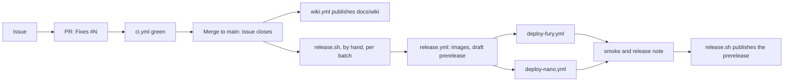

# Release and Deployment

> [!NOTE]
> **Historical record.** The release and deploy workflows, their self-hosted runners and `scripts/release/` described
> here belonged to the original maintainer's two demo devices and are **not part of this public repository**; only
> `ci.yml` (GitHub-hosted runners) is. To run Aware Care on your own ZGX Nano or Fury, follow the
> [README](https://github.com/ataturhan21/HP-Edge-AI-Demo-Aware-Care/blob/main/README.md#run-it): `./demo.sh local`.

Full procedure: [delivery runbook](https://github.com/ataturhan21/HP-Edge-AI-Demo-Aware-Care/blob/main/spec/engineering/08-delivery-and-nano-runbook.md). Decisions: [ADR-010](https://github.com/ataturhan21/HP-Edge-AI-Demo-Aware-Care/blob/main/spec/decisions/ADR-010-delivery-workflow.md), [ADR-018](https://github.com/ataturhan21/HP-Edge-AI-Demo-Aware-Care/blob/main/spec/decisions/ADR-018-second-device-zgx-fury.md) (two devices) and [ADR-019](https://github.com/ataturhan21/HP-Edge-AI-Demo-Aware-Care/blob/main/spec/decisions/ADR-019-lean-delivery.md) (lean delivery).



| Workflow | Trigger | Result |
|---|---|---|
| `ci.yml` | Pull requests to `main`, pushes on `main` and the merge queue (`merge_group`) | Workflow lint, traceability, contracts, backend and browser tests (mock, 8 shards), web build, package smoke test, Wiki lint and tooling tests, dependency audit, CI gate |
| `release.yml` | Manual, from `main` | linux/arm64 images from a CI-verified commit, tag `v<version>`, **draft prerelease** with digests and manifest |
| `deploy-nano.yml`, `deploy-fury.yml` | Manual, at a release tag | Deployment to `demo-zgx-nano` / `demo-zgx-fury` (each approved at its environment, `v*` tags only), readiness, flow and presenter checks, evidence, **rollback on failure** |
| `wiki.yml` | Push to `main` that changes `docs/wiki/` or its publisher; manual | Publishes `docs/wiki/` to this Wiki |

## Releasing

Release per batch or milestone, not per bug. One command, run by hand:

```bash
scripts/release/release.sh <version>      # e.g. 0.19.0-demo.1; --dry-run prints the plan; --only nano|fury
```

It checks that `main`'s HEAD has a green push CI run, runs `release.yml`, then runs both deploy workflows **at the same time**. A device that is not ready is **skipped** with a reason (runner offline, another deploy run queued or running, SSH host not answering) and the release goes on for the other; each run is the one GitHub's reply to its own dispatch names, so a concurrent dispatch's run is never approved, cancelled or downloaded (#584); an approval GitHub refuses is retried a few times, then reported with GitHub's HTTP status and message (#620); a deploy still queued after 5 minutes or unfinished after 15 is cancelled with its cause, waiting for approval, a busy runner or an offline runner (`AWARE_CARE_DEPLOY_QUEUE_TIMEOUT`, `AWARE_CARE_DEPLOY_TIMEOUT`, in seconds; each smoke stops after `AWARE_CARE_SMOKE_TIMEOUT`, default 720). It reaches the Fury over SSH (`AWARE_CARE_FURY_SSH`); the Nano is the machine it runs on unless `AWARE_CARE_NANO_SSH` names one. `AWARE_CARE_FURY_MODEL` / `AWARE_CARE_NANO_MODEL` override the manifests' model IDs, and the results go to `AWARE_CARE_RELEASE_DIR` (default `~/aware-care-release/<tag>`). A skipped or failed device makes the exit status 1; the note still lists every device. Next it smoke-tests each device for about three minutes: readiness, one patient consultation from the home page's Patient choice, and all three presenter Quick flows (Guidance, Self-care, Urgent) on the device AI. Any flow that does not show its result fails the release (#538). Then it writes the **short release note** into the GitHub release: the PRs since the previous release, the deploy result per device and the smoke results. Finally, after a successful run (every selected device deployed and passed its smoke), it **publishes** the release, still marked prerelease (#600); otherwise the release stays a draft and the output prints the `gh release edit <tag> --draft=false --prerelease` to run later.

- **One AI job per device model:** AI harnesses run through `scripts/dev/with_model_lock.sh <command>` (`run.sh`, `./demo.sh check-model`, the release smoke and a local-mode deploy's checks, so also `./demo.sh local`/`setup` and both deploy workflows, take the lock themselves, #578); a second job waits and says which job holds the model.
- **Finish a release whose tag already exists** (#621; an earlier run built the tag but did not deploy or publish it): run `scripts/release/release.sh <version>` again. It skips the build and deploys, smokes, writes the note and publishes, but only when the tag points at `main`'s HEAD, that commit's push CI run succeeded and the tag's release run (named in its `release-manifest.json`) succeeded. When `main` has moved on, `release.sh --deploy-only <version>` finishes the tag at its own commit. A tag at another commit, a red commit or no successful release run stops it before anything is deployed.
- **Re-run the smoke** against what the devices run now (read-only): `scripts/release/release.sh --smoke-only [fury|nano|both]`. Port 18180 must be free.
- **Not part of a release any more:** a release PR, an evidence folder, screenshots, repeated suite runs on the Nano and backups. The data is synthetic; `scripts/release/backup.sh` stays available by hand.
- **Models:** both devices serve `qwen3.6-35b-a3b-fp8`: qualified on the Nano (ADR-002), and on the Fury since 2026-10-28 by the owner's decision with its own GPU memory fraction 0.20 (ADR-018 amendment 1; the release passes it to the Fury's deploy and smoke from `infra/fury/model-manifest.json`). ZRT serves each model from a user unit at boot (`infra/*/zrt/`), outside app deployment.

## Current deployment state

**What runs now:** `./demo.sh status` on the device (its `Local:` line names the release, mode and model), or the newest GitHub release whose note says the device was deployed: each release note records what each device received. Last checked 2026-10-26: both devices ran `v0.18.2-demo.1` in local mode (its release note: both deployed, both smokes passed). Release records up to `v0.15.1-demo.1` are in [`evidence/releases/`](https://github.com/ataturhan21/HP-Edge-AI-Demo-Aware-Care/tree/main/evidence/releases); later releases keep their note in the GitHub release only.

## Presenter access

One tunnel and one address serve patients and presenters (#487):

    ssh -N -p <ssh-port> -L 18180:127.0.0.1:8180 <user>@<host>

(`<ssh-port>` is the device's SSH port: usually 22.) Open **http://127.0.0.1:18180**: the API accepts only the configured origin, and the gateway redirects `http://localhost:18180` there (#690). The home page offers **Patient** (start or continue a consultation) and **Presenter** (the presenter tools at Demo scenarios, O03). The presenter tools call the gateway's `/presenter-api` path, which works only when the device has a presenter key (runbook section 10). Their three one-click flows (guidance, self-care, urgent warning sign) run the device's AI live: about 2 s on the Fury and 11–25 s on the Nano. How to present, step by step: the README's [Present it](https://github.com/ataturhan21/HP-Edge-AI-Demo-Aware-Care/blob/main/README.md#present-it). The deploy tool refuses a presenter key on a gateway that binds a non-loopback address (ADR-005).

**Demo tips:** answer as the fictional person would (explanations follow the confirmed answers); a live scenario's level and wording come from the reviewed pathway and the model, not from a script (ADR-016); reopen a case from **History**.

## Rolling back

For the two demo devices (maintainer):

1. Dispatch the device's deploy workflow with the previous tag, the same model and mode `local` (take them from the device's `state/previous.json`), and approve it at the environment. Never roll back on the device by hand while GitHub is reachable.
2. Check the workflow's readiness, flow and presenter results, then `scripts/release/release.sh --smoke-only <device>`. After a rollback the rollback target is empty by design (#300).
3. To return, dispatch the deploy workflow again with the newer tag.

Measured on the Nano (2026-10-21, #374): about 55 s per move, at most 1 s not ready, data intact.

## Safety nets of the deploy tool

- A failed, cancelled or timed-out deployment restores the previous release (#294): re-checked after a failure (`ROLLED_BACK` or `ROLLBACK_FAILED`), restarted unchecked after a cancel (`RESTORED_UNCHECKED`; run `nano_deploy.py status`).
- Images must carry the release commit as their revision label (#297).
- A successful rollback clears `state/previous.json`, so a second rollback cannot redeploy the release just left (#300).
- A failed release run in its draft job is finished with `gh run rerun <run-id> --failed`; the tag is reused only at the verified commit with the same manifest (#298).
- CI for pushes to `main` is never cancelled, because a release needs a green push run for its exact commit (#298).

## What a deployment never does

It never changes ZRT, drivers, CUDA or the GPU, never falls back from local to mock, and never marks a requirement verified.
