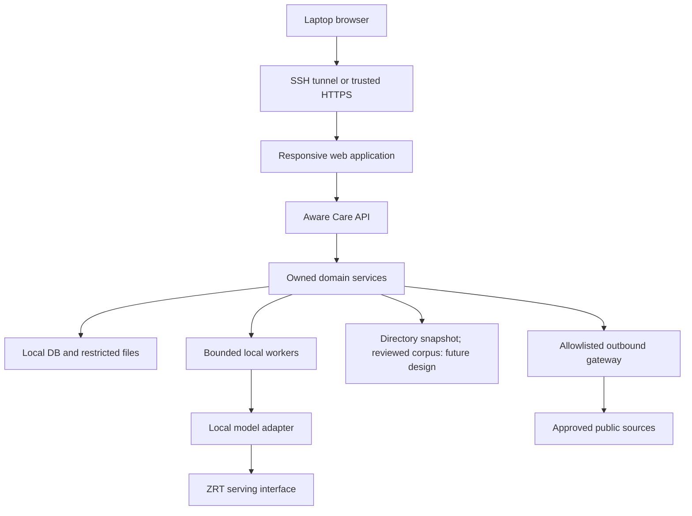

# 01 Architecture and ownership

Baseline: product master 2.0. Handoff: 1.0.0. This is the implementation design; requirement status lives in the registries and evidence, not here. Read repository decisions and `../product.md` before editing.

## Deployment contract

Aware Care's first release is a single responsive web application with exactly 25 screen IDs (24 source screens plus W06, ADR-017). Mobile means the responsive layouts of the same routes. It is a synthetic healthcare navigation demonstration for CIO/CTO audiences, not a real-patient service. The positioning is: “A local AI healthcare demo on HP ZGX, designed for future deployment at the healthcare edge.”

One HP ZGX Nano hosts application API, database, file storage, bounded workers, local retrieval (*Future design: not built (ADR-004); local mode needs no corpus today*) and ZRT. The remote laptop hosts VS Code and the browser. Claude Code executes developer tools in the remote repository but its coding-model requests use its configured Claude provider, not ZRT. Keep synthetic fixtures and code in that development context; the product does not inherit a cloud fallback because the coding assistant uses a cloud service.

ZRT is the only selected model-serving interface. The installed CLI wraps vLLM internally, but this project must not deploy a competing standalone vLLM or Ollama service. An existing unrelated Ollama listener may remain untouched. Do not change drivers, CUDA, system Python, or runtime service configuration without a specific authorized task.

| Service | Development binding | Status |
|---|---|---|
| Web development server | `127.0.0.1:5173` | Implemented (`apps/web/vite.config.ts`, strict port; `AWARECARE_WEB_PORT` overrides it) |
| Aware Care API | `127.0.0.1:8000` | Implemented; preserves ZRT default port |
| ZRT API | `http://127.0.0.1:8080/v1` | Installed CLI's default; verified serving (`infra/model-manifest.json`) |
| SSH | `<ssh-port>` (default 22) | Observed Nano listener |
| Database/files | Local/internal only | SQLite and files under `AWARECARE_DATA_DIR` (default `runtime-data/api`) |

Use a Vite `/api` proxy to port 8000 in development. The browser calls relative `/api/v1/...` URLs. The browser must never know the ZRT endpoint or hold its credentials. At demo release, serve built static assets and API through a trusted HTTPS reverse proxy with separate runtime identity; a Vite development server is not the release service.

## Modules and file ownership

| ID | Backend package | Requirements | Owns |
|---|---|---|---|
| M01 | `modules/access/` | R01-R03 | Sessions, consent, identity/role boundary |
| M02 | `modules/profiles/` | R04-R06 | Unknown facts, profile save and confirmation |
| M03 | `modules/cases/` | R07-R10 | Case revisions, state machine, history |
| M04 | `modules/intake/` | R11-R14 | Deterministic approved questions and slot accounting |
| M05 | `modules/safety/` | R15-R17 | Reviewed urgency/scope rules and fail-closed gates |
| M06 | `modules/records/` | R18-R20 | Restricted extraction, provenance and fact review |
| M07 | `modules/evidence/` | R21-R23 | Corpus and controlled outbound gateway (*Future design: not built (ADR-004); local mode needs no corpus today*; today it lists a guidance's claims with no sources) |
| M08 | `modules/guidance/` | R24-R27 | Structured generation, validation and atomic publish |
| M09 | `modules/providers/` | R28-R31 | Factual directory eligibility, ranking, contact handoff |
| M10 | `modules/exports/` | R32-R33 | Reviewed summary and expiring PDF |
| M11 | `modules/privacy/` | R34-R36 | Retention, deletion and local data boundary |
| M12 | `modules/operations/` | R37-R40 | Truthful runtime, measurements and traceability |

Paths above are under `apps/api/app/`. Each module has `service.py`, plus `routes.py` when it exposes operations, `schemas.py` when it defines request models, and `repository.py` only if it owns persistence. Cross-module calls use explicit service interfaces. UI components do not implement clinical rules or SQL. Shared components may support many screens, but every runtime file must be registered with its requirement IDs.

## Suggested implementation order

1. Inspect the existing repository, validate the specification lock and identify existing framework choices.
2. Preserve working exported frontend code; map all 25 routes to their stable screen IDs (W06 added by ADR-017).
3. Implement strict contracts, session boundaries and state-machine transactions without a model.
4. Complete an explicitly synthetic mock journey, including urgent/limited/no-match/error/reset variants.
5. Implement the runtime adapter and test actual ZRT transport independently of clinical enablement.
6. Add reviewed pathways/corpus only after named review artifacts are supplied. Keep live clinical guidance unavailable while these gates are unmet.
7. Execute acceptance/UI checks and actual-device rehearsals; store measured evidence with the exact release.

Default mock mode must work without ZRT. Local mode must fail visibly if ZRT, clinical safety or evidence is unavailable. No silent switch to mock or cloud is permitted. A successful model ping does not mark the healthcare application clinically ready.
