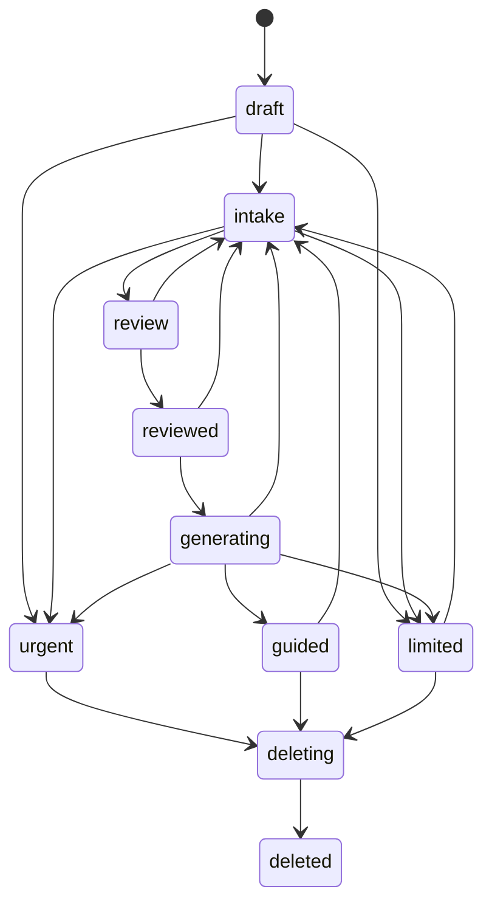

# 02 Case state, revisions and intake

Owner M03/M04/M05. Requirements R07-R17, R20, R24, R27, R35. Exact states are preserved from master 2.0. Domain services, not frontend controls or model text, authorize state transitions.

## State transitions

| State | Permitted next state | Guard or action |
|---|---|---|
| draft | intake | Concern persisted, supported scope and safety checks pass |
| draft | urgent | Reviewed urgent rule fires |
| draft | limited | Unsupported scope or required safety check fails |
| intake | intake | Answer/edit/confirmed fact persists and checks rerun |
| intake | review | Required context complete, no eligible question or ten slots issued |
| intake | urgent / limited | Urgency or scope/failure interrupt |
| review | reviewed | Explicit user confirmation of current revision |
| review | intake | Accepted clinical edit invalidates review |
| reviewed | generating | reviewed_revision equals current revision; prerequisites pass |
| reviewed | intake | Clinical edit |
| generating | guided | Validated output commits for the same reviewed revision |
| generating | limited | Generation/validation fails after permitted repair |
| generating | urgent | Reviewed urgent finding supersedes routine output |
| generating | intake | Edit; in-flight output is stale |
| guided | intake | Clinical edit; derived artifacts invalidated |
| urgent | urgent | Urgent instructions, history and deletion only; a restart creates a new case |
| limited | intake | Corrected supported inputs or an explicitly recoverable retry passes prerequisites |
| active state | deleting | Authorized deletion/expiry/reset immediately revokes health access |
| deleting | deleted | Every dependent store acknowledges purge |
| deleted | none | Terminal; never restore through a late worker or browser navigation |

The implementation may use internal transition events, but it must preserve these public states. General help remains available without a case. An urgent case does not expose routine guidance, export based on routine guidance, intake or provider ranking.

Deletion edges from other active states are omitted from this diagram for readability; the transition table governs them.

## Revision transaction

Acquire the case row lock (or a single-writer transactional equivalent). Check authenticated owner, tombstone, expected revision and allowed state. Validate the clinical mutation and resolve any server-owned references. Apply it, increment revision once, clear reviewed_revision and invalidate current guidance/search/export pointers. Re-evaluate scope and urgency against the new immutable facts. Commit state and sanitized audit event together. Return the new revision and next action.

Review confirmation records `reviewed_revision=revision`; it does not itself invent another clinical revision. Question issuance is a serialized slot-allocation operation, not a clinical answer change. Changing provider preferences creates a search/criteria version and does not alter clinical answers. Implementation details must not invalidate the same job merely because its state moved from reviewed to generating.

A worker captures case ID, actor ID, input revision, reviewed revision, pathway/corpus/model versions and deletion generation. At commit, lock and check all again. If changed, mark stale and discard unpublished output. If deleted, cancel and purge. Do not temporarily attach stale output and then remove it after the UI has read it.

## Question accounting

- Allocate a slot only when a **new question** is issued. Valid range 1-10, unique by case/slot.
- Return the existing active prompt on refetch or same-key retry. Do not allocate again.
- Answering, skipping, changing an answer or direct editing does not allocate a new slot.
- Invalidated questions still count as issued. Never reset issued_slots after an edit.
- Clarifying a contradiction with a new prompt consumes a slot; direct correction of the original answer does not.
- At ten slots return `review_required` with unresolved gaps. There is no eleventh prompt.
- Profile entry, optional record review and provider preference fields are outside the intake question count and must be clearly labeled.

A UI shows “Question n of up to 10”. It does not promise exactly ten questions if reviewed completion criteria permit fewer.

## Deterministic selection

Inside a serialized transaction: reject stale/unsafe state; return the active question if one exists; stop at cap; compute missing required facts and contradictions; filter reviewed templates by eligibility and already-known facts; sort by reviewed urgency priority, then decreasing required-gap coverage, then stable template ID; issue the first template. The initial release uses reviewed text and options verbatim. Optional future paraphrasing cannot alter template identity, meaning, choices, required fields or count and needs its own evaluated decision.

Do not use an LLM to invent the next question. Do not send provider preferences to the intake selector. If there are no eligible templates, return review with gaps rather than looping.

## Answer validation

| Type | Validation |
|---|---|
| single_choice | Exactly one ID from the issued options |
| multiple_choice | Unique issued option IDs; exclusive none/unknown cannot coexist with positives |
| text | Trim outer whitespace; answered content 1-2000 characters; interpretation labeled separately |
| scale | Integer within issued inclusive bounds; absent is not zero |
| duration | Nonnegative number plus hours/days/weeks/months/years; preserve unit |
| unknown/skipped | Null value; unresolved critical information remains unresolved |

Validate against the stored issued question, not a client-supplied response type. Preserve valid prior answers when rejecting a new one. At most one current answer per question; retain minimal revision metadata within retention limits.

## Clinical gates

Run reviewed urgency/scope checks after initial concern, every answer, clinical edit and confirmed record fact, and before publish. Ambiguous or uninterpretable free text is undetermined, not negative. Urgent rules preempt routine questions, self-care suggestions and provider ranking. The model cannot reduce urgency.

No generic list of rules in this pack is clinically approved. Review artifacts must supply exact predicates, wording, timing and supported scope. Pediatric, pregnancy-specific and specialized mental-health pathways remain disabled unless separately reviewed. A critical unresolved gap prevents reassuring self-care, even at the question cap.

The mock scenario layer may demonstrate transitions through named, synthetic scripted scenarios. It must not evaluate arbitrary real symptoms using unreviewed clinical rules. Tests of mock routing do not count as validation of clinical triage performance.
