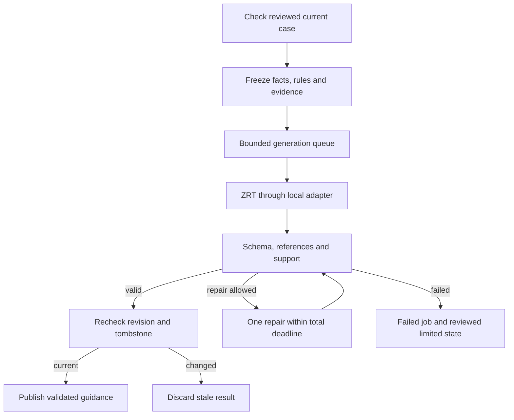

# 04 ZRT, generation and evidence

Owner M07/M08/M12 with `apps/api/app/runtime/adapter.py`. Requirements R21-R27, R34, R37-R38. The sole selected serving interface is **HP ZRT**. No standalone vLLM/Ollama installation or model-switching command is prescribed by this document.

## Observed and unresolved runtime facts

The user supplied Nano output shows ARM64, Ubuntu 24.04.4, NVIDIA GB10, driver 580.173.02, ZRT 0.39.0 Snap revision x3 and no served models. The CLI documents an OpenAI-compatible default `http://127.0.0.1:8080/v1/`. These observations do not prove model compatibility, a functioning endpoint, structured output support or readiness. `CUDA Version: 13.0` in nvidia-smi is driver-reported support, not an inventory of the runtime's toolkit. Later observations: the Nano's model manifest records ZRT 0.43.0 (Snap x4) serving `qwen3.6-35b-a3b-fp8` (`infra/model-manifest.json`), and `./demo.sh doctor` reports the ZRT now installed.

Application Python uses its own uv environment with Python 3.12. Do not install application packages into ZRT's packaged environment or Conda base. Keep the app API at port 8000 to avoid the ZRT default 8080. Model IDs, weights, tokenizer revisions, quantization and context size are pinned per device in `infra/model-manifest.json` and `infra/fury/model-manifest.json` (ADR-002), and for other machines in `infra/models/catalog.json`.

## Adapter interface

The application depends only on:

```python
async def generate_json(task, prompt_version, input_snapshot, schema_id, timeout_s): ...
async def health(): ...
async def manifest(): ...
```

Concrete types may be implemented around this interface, but keep these semantic arguments. `generate_json` returns parsed candidate data or a typed sanitized transport/validation error. It does not return raw text to HTTP routes. The domain output validator then decides whether the candidate is publishable. An interface Protocol file is not a serving implementation.

Read endpoint, model ID and credentials from backend-only configuration. Permit only the configured local endpoint; no user URL or prompt can alter it. Probe the actual ZRT endpoint and returned model identity before fixing the manifest. Keep generation parameters/prompt hash and provider adapter version with each result. No silent fallback to cloud, Ollama, a different model, a mock answer or a prior cached patient result.

`health()` reports actual transport/model availability with content-free diagnostics. `manifest()` reports measured/configured identity, including unknown fields as unknown. A listening socket or successful process launch alone is not proof of successful inference.

## Queues and deadlines

One active generation and three queued requests initially. Excess requests receive 429 plus Retry-After. Central admission must coordinate every use of the same inference runtime, including model-backed extraction, so multiple workers cannot each assume they own the one active slot. The concern screens that run inside a request (createCase and editCase's red-flag screen and concern check, a written-urgency scenario load) pass the same central admission in their own lane with the same bounds: one screening on the runtime, three waiting, at most one per session, and 429 `QUEUE_FULL` with Retry-After beyond; a duplicate with the same Idempotency-Key waits and replays (#397, CHG-DEV-SEC-002). At most one generation and one screening reach the runtime at once. Do not unload/switch models or refresh the directory during an active consultation.

Generation has a total 60-second deadline including a maximum of one repair. Do not give each retry another full 60 seconds. Queue time is measured separately and must be bounded by an explicit configured expiry, documented before implementation freeze. The master does not prescribe that queue expiry value. Browser disconnect is not automatic cancellation; actor/session expiry, deletion, timeout and stale revision are cancellation/invalidation causes.

Memory is shared by CPU/GPU on GB10. Reserve headroom for operating system, API, OCR and local indexes. Pin context/output budgets only after fitting the full prompt, schemas and up to 6000 evidence tokens (the evidence budget: *Future design: not built (ADR-004); local mode needs no corpus today*). A model that fits weights in memory may still fail under context or KV-cache load. Do not reuse GB300 concurrency settings on this Nano.

## Generation stages



The repair loop is bounded by an attempt counter, even though the diagram shows a cycle. No chain-of-thought is requested or exposed.

Prompt inputs are separately labeled: instructions, fixed schema, confirmed facts, uncertainty, immutable urgency decision, pathway version and evidence. Treat records and retrieved text as untrusted data, not instructions. No model tool calling or external internet access. Initial demo clinical content is restricted to reviewed templates or clinician-reviewed fixture outputs.

Post-generation validators check strict JSON schema and bounds, owned known fact IDs, known approved evidence IDs, actual statement support, urgency policy, prohibited certainty, current revision and deletion state. A known citation ID alone is not support. Validate clinical statements appearing in case_summary, explanations, rationale, actions, clinician questions and escalation prose as well as explicit `claims[]`; a prose field must not become an evidence bypass.

A definitive diagnosis, guaranteed safety, ruling out an emergency, fabricated numerical diagnostic confidence or individualized prescription change is rejected. On repeat invalid output, fail the job and serve a reviewed limited fallback rather than partial raw model text. Missing reviewer-approved fallback content is an unmet deployment gate, not permission to invent it.

## Urgency policy

The master requires guidance to equal or be more conservative than the reviewed rule decision. The actual allowed transition policy must be supplied with the reviewed pathway. `undetermined` is not automatically lower or higher than self-care; it blocks reassurance and routes through the reviewed limited policy. Do not infer an ordinal integer from the enum and assume it is clinically valid.

A self-care candidate needs complete required facts and reviewed positive eligibility criteria. Absence of a matched urgent rule is insufficient. The model cannot downgrade the rule decision or choose a physician ranking while the case is urgent.

## Corpus and grounding

**Future design: not built (ADR-004); local mode needs no corpus today.** The design below stays for a future approved corpus; today no claim cites a source, and possible explanations are labelled general knowledge (ADR-015). Primary evidence is a local reviewed corpus. Each item has publisher, permitted use, topic mapping, source date, retrieval date, reviewer, review expiry, content hash and locator. The source publication/update date is separate from retrieval time. Only enabled, in-scope, unexpired approved content can support clinical claims.

*Future design: not built (ADR-004); local mode needs no corpus today.* Chunk by semantic section and retain heading/page locators. Embeddings stay local. Publish a new immutable index atomically. A job keeps one corpus snapshot throughout generation and any repair. Retrieve at most 8 candidates; retain at most 5 passages within a 6000-token evidence budget. These master defaults need testing against the chosen model's context.

If no approved support exists, suppress affected claims and disclose the limit. If review has expired, exclude from new clinical claims even if the original page remains online. A temporary network outage does not invalidate an otherwise valid local snapshot. Show cached mode and dates.

## Outbound gateway

The local gateway permits enumerated, reviewed endpoint/query schemas only. Reject arbitrary user URLs; prevent SSRF against loopback, private-network, link-local and metadata addresses before and after DNS and each redirect. Apply timeout, redirect and response-size caps. Exact values beyond master-specified limits require a recorded infrastructure decision.

Clinical refresh is a presenter-controlled ingest using approved source IDs, not symptom-driven browsing. Connected provider lookup can use approved specialty and city/ZIP only after user choice. Never send raw symptoms, names, history, records, transcripts, case IDs or rare-condition free text. Do not log query values. User browser contact/source handoff still reveals its IP and requested page; make that boundary explicit.

## Readiness and evidence

In local mode, routine guidance readiness requires DB, writable storage, the active reviewed pathway and a served configured model; no corpus is required (ADR-004). No active pathway or no configured model ID is `unavailable`; a model ZRT does not serve or an unreachable runtime is `degraded` (cases start, generation fails visibly with a retry), with no concealed fallback (`apps/api/app/modules/operations/service.py`). In mock mode, readiness refers only to synthetic application dependencies and must say mock in the UI.

Targets are next question within 5 seconds and guidance within 20 seconds in at least 9 of 10 warm single-user rehearsals. They are not observed results. Record cold startup separately and queue/retrieval/inference/validation/total stage timings. Associate evidence with commit, spec hash, device inventory, model manifest, pathway/corpus versions and fixture. Do not mark a hardware or clinical release ready solely because static contract checks passed.
